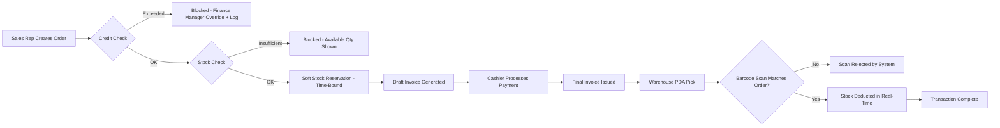
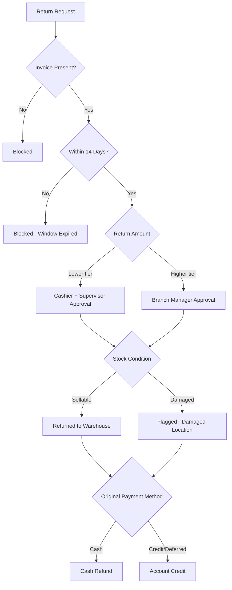
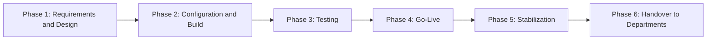
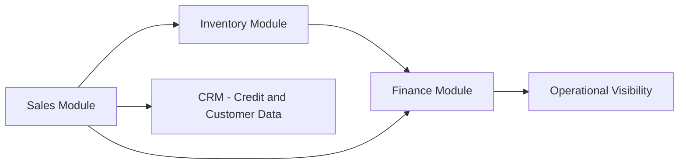
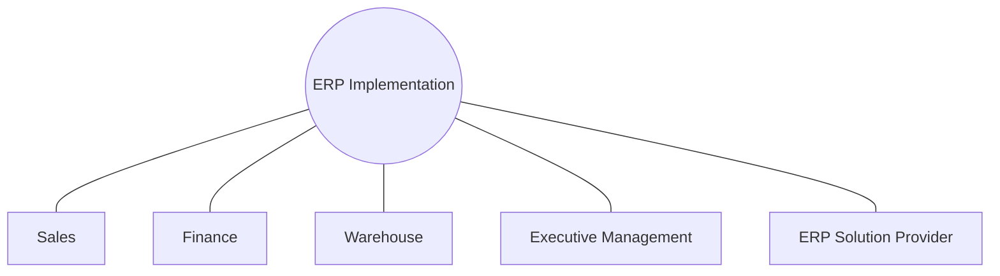

# Multi-Branch ERP Implementation

**Case study** · FMCG retailer and wholesaler, Saudi Arabia · Jun 2020 – Aug 2021 · Role: ERP Business Analyst

This is the full write-up behind the [README](../README.md). It follows the rollout through its six phases, from requirements to handing the new processes over to the departments that run them. The detailed requirements and rule specifications are in the [BRD](BRD.md).

## Starting point

The company ran a custom in-house system across its 7 branches. It recorded invoices but did not deduct stock, reserve it, check credit limits, or control approvals. The [gap analysis](https://github.com/omaralburiki/Inventory-Gap-Analysis-ERP-Readiness) done before this project had already measured the problem. In system terms it came down to 6 failure conditions: no real-time inventory synchronization, no stock reservation, no negative-stock prevention, no credit limit enforcement, no approval governance with an audit trail, and no reliable financial reporting. These were consistent with the root causes found in the gap analysis, and they called for replacing the system, not patching it.

The goals were to move to an integrated ERP covering finance, inventory, sales, purchasing, HR, CRM, and POS; to remove phantom inventory and keep stock accurate in real time; to stop negative-stock sales and enforce credit limits automatically; to digitize wholesale order fulfillment; and to put procurement and returns under structured control with a full audit trail.

The scope covered 7 branches, 150+ users, 7 modules, the migration of more than 10,000 SKUs, and rules that applied company-wide, not to one branch type.

## My role

I was the main business analyst on the business side of the rollout, from requirements through stabilization. I gathered requirements, wrote the BRD and functional requirements, designed the business rules, ran UAT against each rule, trained users, coordinated master data migration, supported go-live, and provided on-site hypercare. The ERP solution provider configured the system. Approval for overrides and for go-live stayed with Finance and management.

## Phase 1: Requirements and design

I gathered requirements directly from Sales, Finance, Warehouse, and Executive Management. Several needs had no equivalent in the old system: separate price lists for wholesale, supermarket, and mini-market branches; stock held centrally and per branch, with tracked transfers between them; batch and expiry tracking; and a purchasing workflow that compares supplier quotations before a purchase order is issued.

I documented these in the BRD and functional requirements. That documentation was the basis for the vendor's configuration and, later, for the UAT acceptance criteria.

## Phase 2: Configuration and the business rules

The ERP solution provider configured all 7 modules against the BRD. In this phase I designed the company-wide order and inventory rules with the stakeholders who would work under them, and the vendor built them into the system. None of them existed before.

- **Hard stock block.** An order cannot exceed available stock; the system shows the quantity that is available.
- **Credit limit check.** An order is blocked when the customer's balance is over the approved limit. The Finance Manager can override it with a logged reason.
- **Soft stock reservation.** Stock is held against a draft order for a set period, then released automatically, or earlier by a supervisor with a reason code.
- **Deduction at pick.** Stock is deducted when the warehouse confirms the pick by barcode scan, not when the order is created.
- **Negative-stock prevention.** Any transaction that would take stock below zero is rejected. Only the CFO can override it, and the override is logged.
- **Returns approval.** A return needs the original invoice and must fall within 14 days of the invoice date. The approval level depends on the amount, the refund follows the original payment method, and returned stock is classed as sellable or damaged.

Every override is logged with the user, the reason, and the time.

The order lifecycle became: the sales representative creates the order, including large orders of 100+ lines; a draft invoice is generated; the cashier takes payment; the final invoice is issued; and the warehouse picks and confirms the order with a PDA scan.

## Phase 3: Testing

I ran UAT on the core order, inventory, and credit workflows before go-live, testing each rule against the gap it was meant to close.

- **Credit control.** The old system had no credit limit per customer. Staff searched each customer by hand and read an aging report before deciding, with no alert for an exceeded limit or overdue terms. UAT confirmed the automated check replaced that.
- **Stock reservation.** The old system showed no available quantity at order entry and reserved nothing. UAT confirmed the time-bound reservation and the real-time availability display.
- **Batch and expiry.** The old system had no batch tracking. UAT confirmed that expiry dates are captured by scan at goods receipt, that stock can be rotated by expiry, and that an alert is raised 6 months before expiry.
- **Pricing.** UAT confirmed the right branch-type price list at order entry. Customer-segment pricing was out of scope; it came later with the B2B platform.

Defects went into a ticketing system, and I followed them up directly with the ERP solution provider.

| Capability | Old system | New ERP |
|---|---|---|
| Credit control | Manual customer search and aging report, no alerts | Automated credit check, Finance Manager override with log |
| Stock at order entry | No reservation, no availability shown | Real-time availability, time-bound reservation |
| Batch and expiry | Not supported | Expiry captured by scan at receipt, 6-month alert |

## Phase 4: Go-live

Go-live brought the problems you would expect in a change this size. Orders with 100+ lines were slow to enter, users made mistakes while they learned the new system, and work backed up at the handoffs between sales, cashier, and warehouse. Around go-live I coordinated the migration of more than 10,000 SKUs and supported all 7 branches.

## Phase 5: Stabilization

The aim was to make the new process the only process, so old shortcuts did not survive next to it. I enforced the Sales, Cashier, Warehouse flow as the single path for an order, and made barcode scanning mandatory at picking, with the system rejecting the wrong item or quantity. I was on site for hypercare and worked with the ERP solution provider on the issues that came up.

## Phase 6: Handover to departments

Once things were stable, day-to-day ownership of inventory control and of finance and operational alignment moved to the Inventory and Finance departments. My role became performance monitoring and coordination between departments.

| Area | During the rollout | After stabilization |
|---|---|---|
| Inventory control | Coordinated by me | Inventory Department |
| Finance and operational alignment | Coordinated by me | Finance Department |
| Cross-department monitoring | Not applicable | Me (ongoing) |

## How the modules connect

## Outcome

The ERP went live in all 7 branches, with the same processes across finance, inventory, sales, purchasing, CRM, HR, and POS. Credit limits, stock reservation, and negative-stock prevention were enforced company-wide for the first time. Transaction processing and barcode pick accuracy improved after go-live, based on day-to-day observation; they were not measured in a formal post-implementation audit.

This project was part 2 of the company's ERP work. The ERP later became the source of truth for stock and prices on the [B2B E-commerce platform](https://github.com/omaralburiki/B2B-E-commerce-Implementation).
